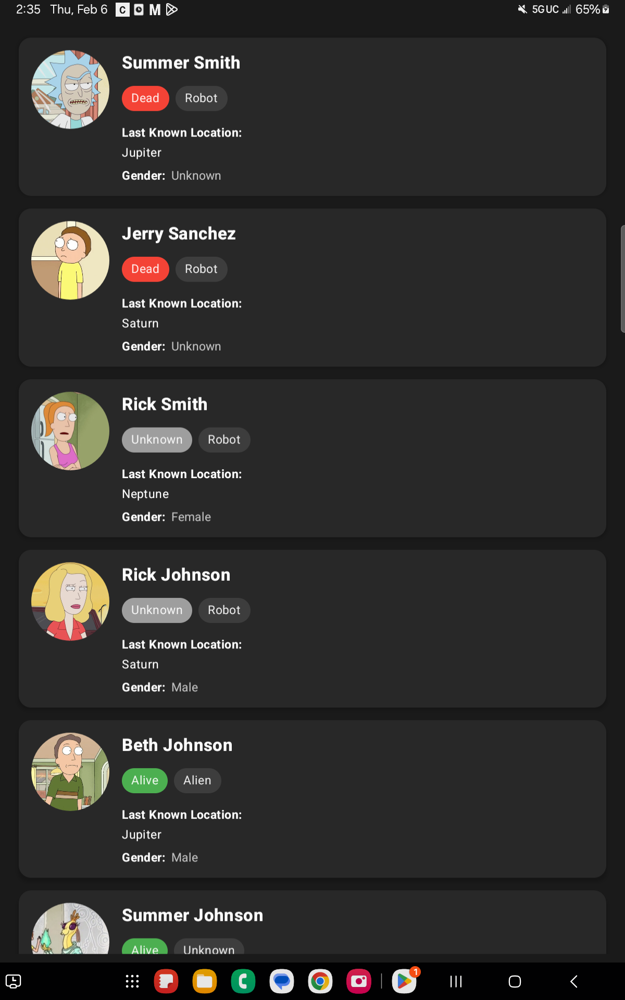
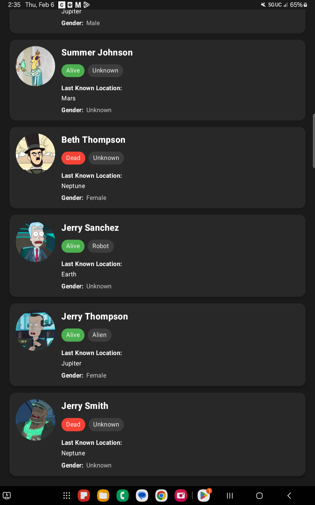
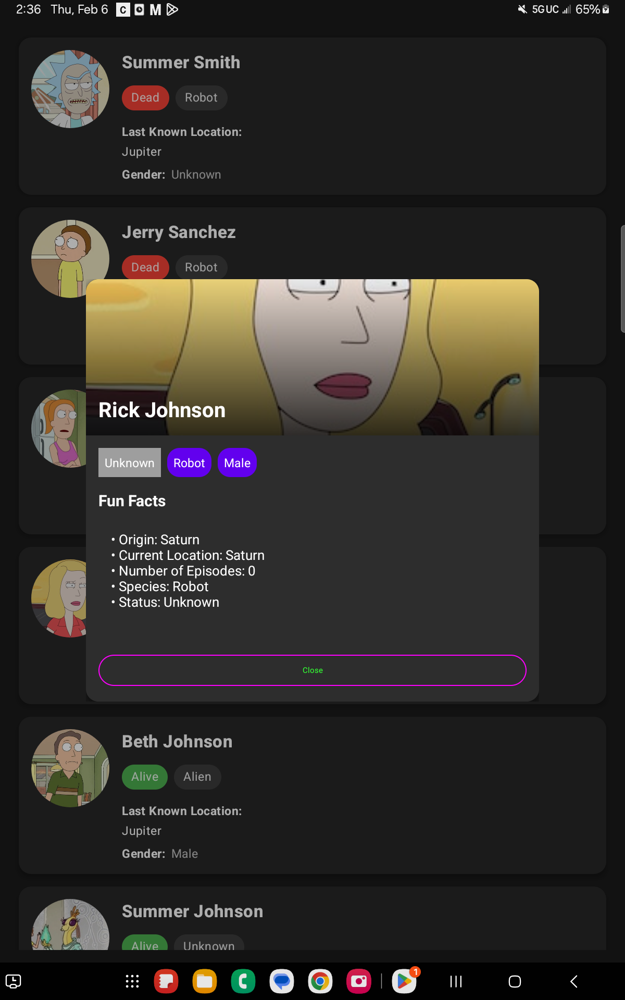
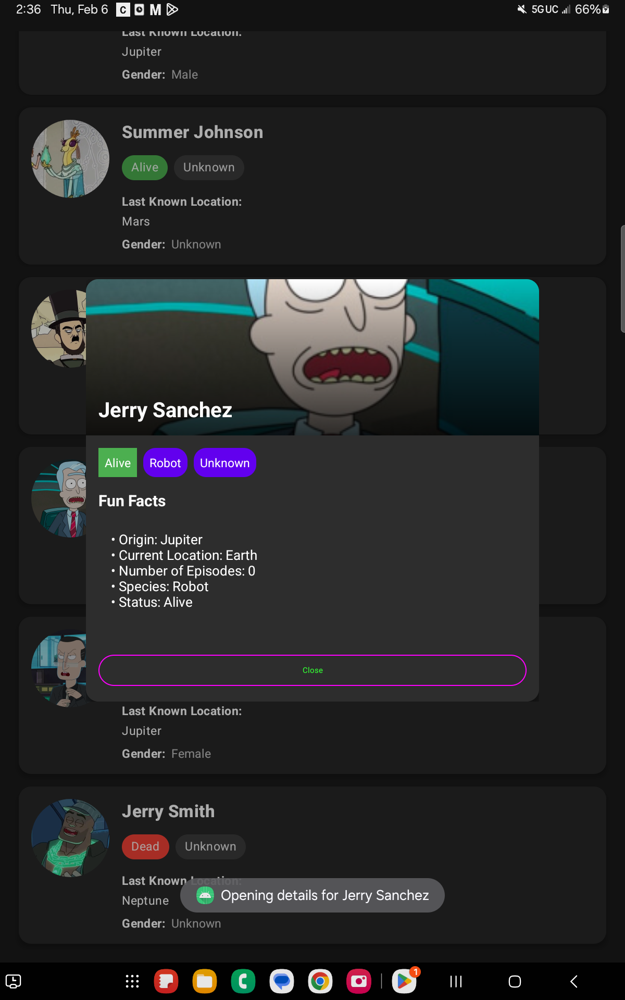
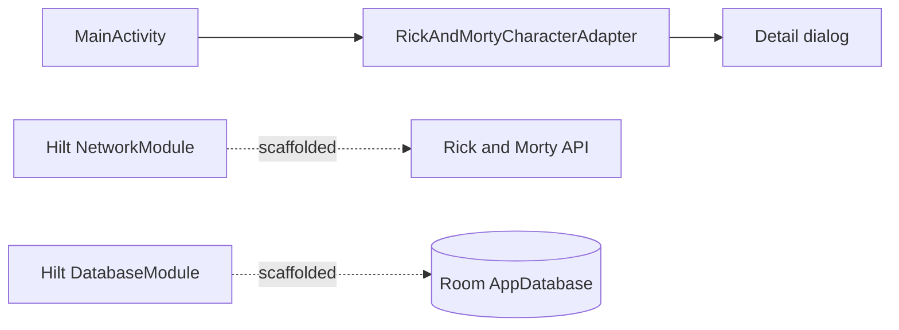

<div align="center">

# Rick and Morty Character Viewer

An Android app that lists Rick and Morty characters in a Material Design card list and opens a detail dialog for each one.


</div>

> Built as a class assignment for an Android development course. The project uses the course's `edu.nku.classapp` starter package.

## Overview

The app shows a scrollable list of characters, each with a circular avatar, name, status and species. Tap a character to open a detail dialog with a large header image, status/species/gender chips and a short facts section. In the current build, the list is filled with 10 generated sample characters. Their avatars are loaded from the public [Rick and Morty API](https://rickandmortyapi.com/) image CDN. A Retrofit client and a Room cache for the full API are scaffolded but not yet wired into the screen.

## Features

- **Character list**: A `RecyclerView` of `MaterialCardView` items, with avatars loaded by Coil.
- **Detail dialog**: `MaterialAlertDialogBuilder` with the header image, status/species/gender chips, origin, current location, episode count and type.
- **Status colors**: Alive in green (`#4CAF50`), Dead in red (`#F44336`), Unknown in gray (`#9E9E9E`).
- **Theming**: Custom card, banner and gradient drawables, a list fall-down animation, and a `values-night` theme.
- **API layer (scaffolded)**: A `RickAndMortyApi` Retrofit interface for `character` (paged and filterable by name, status, species, type and gender), `character/{id}`, `location` and `episode`.
- **Offline cache (scaffolded)**: A Room `AppDatabase` with a `CharacterDao` that supports paging, search, favorites and refresh.

## Screenshots

<table>
  <tr>
    <td align="center"></td>
    <td align="center"></td>
  </tr>
  <tr>
    <td align="center"></td>
    <td align="center"></td>
  </tr>
</table>

There is also a screen recording at [`demo/demo.mp4`](demo/demo.mp4).

## Tech stack

| Layer | Technology |
|-------|------------|
| Language | Kotlin (JVM target 17, core library desugaring) |
| UI | Android Views, ViewBinding/DataBinding, Material Components, RecyclerView |
| Images | Coil |
| DI | Hilt (Dagger 2.50) |
| Networking | Retrofit 2, Gson, OkHttp logging interceptor |
| Persistence | Room 2.6 (with Paging), compiled with KSP |
| Build | Gradle Kotlin DSL, compileSdk/targetSdk 34, minSdk 26 |

`app/build.gradle.kts` also declares Firebase, Maps, Lottie, Navigation and Flipper. The current code does not use them.

## Architecture



## Project structure

```
app/src/main/
├── java/edu/nku/classapp/
│   ├── ClassApp.kt                       # @HiltAndroidApp
│   ├── MainActivity.kt                   # Builds sample list, sets up RecyclerView
│   ├── RickAndMortyCharacter.kt          # UI model
│   ├── RickAndMortyCharacterAdapter.kt   # List items + detail dialog
│   ├── data/
│   │   ├── model/                        # Character, Location (Room entities)
│   │   ├── local/                        # AppDatabase, CharacterDao, Converters
│   │   └── remote/RickAndMortyApi.kt     # Retrofit interface
│   └── di/                               # NetworkModule, DatabaseModule
└── res/
    ├── layout/                           # activity_main, item_character, dialog_character_details
    ├── drawable/                         # Icons, gradients, card backgrounds
    └── values/, values-night/            # Colors and themes
demo/                                     # Screenshots and screen recording
```

## Getting started

### Prerequisites

- Android Studio with JDK 17
- An emulator or device running Android 8.0 (API 26) or newer

### Build and run

```bash
git clone https://github.com/abhiishek340/Rick-And-Morty.git
cd Rick-And-Morty
./gradlew assembleDebug
```

You can also open the project in Android Studio, let Gradle sync, and run the `app` configuration. No API key is needed.

## Limitations

- The names, statuses, species and planets in the list are randomly generated sample data. Only the avatar images come from the API.
- The Retrofit and Room layers are not connected to a repository or ViewModel yet.

## Acknowledgments

- Character images and API: [The Rick and Morty API](https://rickandmortyapi.com/)
- UI guidelines: [Material Design](https://m3.material.io/)

---

Built by [Abhishek Yadav](https://github.com/abhiishek340)
